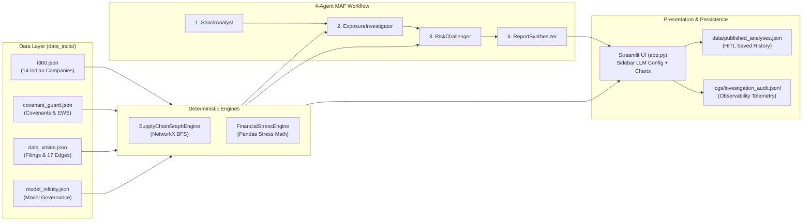

# ContagionIQ — Autonomous Supply Chain & Credit Risk Workbench

**ContagionIQ** is an AI-assisted supply-chain contagion and credit risk analysis workbench. It traces how an upstream commodity or macro price shock (e.g., a +20% surge in coking coal) ripples across **Hop 0** (directly hit producers), **Hop 1** (Tier-1 suppliers & EPC contractors), and **Hop 2** (Auto OEMs & downstream infrastructure) while keeping all financial math deterministic and audit-ready.

---

## Project Background & Motivation

### Why We Selected This Project
* **Siloed Risk Monitoring Misses Domino Effects**: Traditional credit and Early Warning Signal (EWS) systems evaluate each borrower's financial ratios independently. When an upstream raw-material price spike hits a Tier-0 producer, credit teams often discover the downstream impact on Tier-1 suppliers and Tier-2 OEMs/contractors only after quarterly filings lag behind.
* **Bridging Cross-Silo Intelligence**: ContagionIQ unifies four existing **CRISIL** enterprise risk platforms into a single, explainable workflow:
  * **CRISIL `i360`** ([`adapters/i360.py`](adapters/i360.py)): Macro-to-micro research, data, and impact-analytics platform—modeled here to provide core corporate financials (revenue, EBITDA, debt, cash, debt service, working-capital days, base DSCR) and macro/sector shock feeds.
  * **CRISIL `Covenant Guard`** ([`adapters/covenant_guard.py`](adapters/covenant_guard.py)): Credit risk and covenant monitoring platform (under Integral IQ)—tracks bank loan covenant thresholds, headroom percentages, compliance status (`COMPLIANT`, `WATCH`, `BREACH`), and Early Warning Signal (EWS) alerts.
  * **CRISIL `Data XMine`** ([`adapters/data_xmine.py`](adapters/data_xmine.py)): Intelligent document extraction and digitization engine—modeled here to extract supply-chain relationships, dependency percentages, and cited evidence quotes with confidence scores from annual reports, credit filings, and rating notes.
  * **CRISIL `Model Infinity`** ([`adapters/model_infinity.py`](adapters/model_infinity.py)): Enterprise Model Risk Management (MRM) repository and governance platform—tracks model validation status (`APPROVED`, `CONDITIONAL`), known calibration limitations, and drift/performance metrics (`PSI`, `Gini`, `KS`).
* **Deterministic Math + Auditable AI**: Instead of letting an LLM guess financial numbers, ContagionIQ pairs deterministic Pandas/NetworkX engines with a 4-agent AI review (`RiskChallenger` + `ReportSynthesizer`) and a human-in-the-loop (HITL) sign-off gate.

### Why We Used Synthetic Data
* **Data Privacy & Compliance**: Real corporate loan books, borrower financials, covenant thresholds, and EWS alerts are confidential. Synthetic JSON datasets (`data/*.json`) allow full end-to-end development and live demos without exposing proprietary or sensitive client information.
* **Controlled, Reproducible Edge Cases**: The 10-company synthetic dataset is purposefully designed to exercise real-world credit-risk edge cases—including an already-stressed borrower (`AUTO_SUP_B`), a borrower on `WATCH` (`INFRA_A`), stale `FY2024` filings (`DX-8871`, `DX-9021`), low-confidence supply links (`DX-9104` at `0.74`), and conditional model drift (`EWS_COVENANT_V3`).
* **Clean Adapter Abstraction**: All data is accessed through Pydantic-validated adapters (`adapters/`), so synthetic JSON files can be swapped for live databases or enterprise APIs post-demo without changing the core stress engine or agent workflow.

---

## Key Capabilities

* **Deterministic Financial & Graph Engines (Zero LLM Number Guessing)**
  * [`SupplyChainGraphEngine`](engine/graph.py) uses NetworkX multi-hop BFS to trace downstream dependencies, cumulative pass-through factors, and filing evidence trails.
  * [`FinancialStressEngine`](engine/financials.py) uses Pandas to compute stressed EBITDA, margin compression (bps), stressed DSCR, covenant breach status, and working-capital receivables drag.
* **4-Agent Sequential AI Workflow (`SequentialBuilder`)**
  * **ShockAnalyst** → **ExposureInvestigator** → **RiskChallenger** → **ReportSynthesizer** ([`agents/workflow.py`](agents/workflow.py)).
  * Audits filing freshness and confidence (`Data XMine`), surfaces model drift & calibration limits (`Model Infinity`), and synthesizes a structured 5-section Markdown report.
* **Interactive Dark-Theme Streamlit Workbench ([`app.py`](app.py))**
  * **Plain-English UX**: Dynamic executive summary, hover tooltips, glossary, and per-company plain-English verdicts so non-finance stakeholders can understand risk immediately.
  * **Visual Analytics**: Dual Plotly supply-chain network graphs (full network + selected-company subgraph) and a grouped **Base vs. Stressed DSCR** bar chart against bank covenant thresholds.
  * **1-Click Presets, Sector Selector & Exports**: Scenario preset buttons, primary sector selector, and 1-click CSV (`contagioniq_stress_matrix.csv`) and Markdown (`contagioniq_report.md`) downloads.
  * **Persistent HITL Approval & Filters**: Approving or holding a report saves the full snapshot to `data/published_analyses.json` with filters for status, minimum shock %, date, and keyword/company search.
  * **Observability & Audit Telemetry**: [`InvestigationAuditLogger`](observability/audit.py) appends structured JSONL telemetry (run ID, UTC timestamp, latency, cited `DX-*` documents, breaches, HITL status) to `logs/investigation_audit.jsonl`.
* **Multi-Provider LLM Support**
  * Supports **Google Gemini** (`GeminiChatClient`), **Groq** (`OpenAIChatCompletionClient`), and **Local Ollama** (`OpenAIChatClient`).
* **Verified Test Suite & Complete Documentation**
  * **17/17 passing unit tests** (`tests/`) covering financial stress math, 2-hop graph traversal, tool validation, CLI rendering, persistent history filters, decoupled LLM config overrides, Indian FY25 dataset validation, and JSONL audit logging.
  * Full documentation across [`README.md`](README.md) and [`UI_GUIDE.md`](UI_GUIDE.md) (plain-English guide to every chart, KPI, and report section).

---

## Services & Tech Stack

| Layer | Service / Technology | Role in ContagionIQ |
|---|---|---|
| **UI & Visualization** | **Streamlit**, **Plotly** | Dark-themed executive dashboard, interactive supply-chain network graphs, DSCR comparison bars, CSV/Markdown exports |
| **Agent Orchestration** | **Microsoft Agent Framework (`agent-framework`)** | `SequentialBuilder` 4-agent pipeline (`ShockAnalyst → ExposureInvestigator → RiskChallenger → ReportSynthesizer`) & `@tool` bindings |
| **LLM Providers (Decoupled)** | **Google Gemini**, **Groq Cloud**, **Local Ollama** | Runtime-selectable via UI sidebar or `.env` (`GeminiChatClient`, `OpenAIChatCompletionClient`, `OpenAIChatClient`) |
| **Deterministic Engines** | **Pandas**, **NetworkX** | Multi-hop BFS pass-through graph traversal & deterministic EBITDA/margin/DSCR/WC-drag stress math |
| **Data Contracts** | **Pydantic v2** | Strict schema validation across all 4 enterprise data adapters |
| **Persistence & Telemetry** | **JSON / JSONL** | Persistent HITL saved analyses (`data/published_analyses.json`) and structured audit logs (`logs/investigation_audit.jsonl`) |
| **Testing & Config** | **Pytest**, **python-dotenv** | Automated verification suite (`17/17` tests) and environment/secret loading |

---

## System Design & Data Flow



1. **Data Ingestion (`adapters/`)**: Loads and validates company financials, bank covenants, filing evidence, and model-risk metadata via Pydantic v2.
2. **Deterministic Computation (`engine/`)**: Computes exact multi-hop pass-through factors and stressed DSCR/EBITDA/WC drag in Python—**no LLM ever invents financial numbers**.
3. **4-Agent AI Review (`agents/`)**: `ShockAnalyst` extracts the shock → `ExposureInvestigator` calls `analyze_supply_chain_contagion` → `RiskChallenger` audits filings & Model Infinity limits via `get_company_evidence_and_model_audit` → `ReportSynthesizer` writes the 5-section Markdown brief.
4. **Human-in-the-Loop & Audit (`app.py`, `observability/`)**: Analysts inspect charts, approve/hold the report to `data/published_analyses.json`, and every run's latency, cited docs, and status is logged to `logs/investigation_audit.jsonl`.

---

## Project Structure

```text
ContagionIQ/
├── app.py                        # Dark-themed Streamlit + Plotly executive workbench
├── demo.py                       # CLI runner for the 4-agent workflow
├── requirements.txt              # Python dependencies
├── UI_GUIDE.md                   # Non-technical guide to reading the UI, charts, and reports
├── adapters/                     # Pydantic-validated data adapters
│   ├── i360.py                   # Company financials & sector shocks
│   ├── covenant_guard.py         # Bank covenant thresholds & EWS signals
│   ├── data_xmine.py             # Extracted filing documents & supply edges
│   └── model_infinity.py         # Model validation status, limitations & drift metrics
├── agents/
│   ├── tools.py                  # Agent tools (contagion analysis, evidence audit, HITL publish)
│   └── workflow.py               # 4-agent MAF SequentialBuilder workflow & decoupled LLM clients
├── contracts/
│   └── schema.py                 # Pydantic v2 schemas (including ContagionReport)
├── data_india/                   # 14 verified FY25 Indian public companies across 6 sectors
│   ├── i360.json                 # Tata Steel, JSW Steel, Coal India, NTPC, UltraTech, Ambuja, etc.
│   ├── covenant_guard.json       # Covenant & EWS records
│   ├── data_xmine.json           # 16 filing disclosures & 17 directed supply edges
│   └── model_infinity.json       # PD_MODEL_2025 & EWS_COVENANT_V3 governance records
├── engine/
│   ├── financials.py             # FinancialStressEngine
│   └── graph.py                  # SupplyChainGraphEngine
├── observability/
│   └── audit.py                  # InvestigationAuditLogger (JSONL telemetry)
└── tests/                        # Pytest suite (17 tests)
    ├── test_app_history.py
    ├── test_contagion_tools.py
    ├── test_demo.py
    ├── test_financial.py
    ├── test_india_dataset.py
    └── test_observability.py
```

---

## Setup & Configuration

### 1. Install Dependencies
Using the project virtual environment (`..\venv`):
```powershell
..\venv\Scripts\pip.exe install -r requirements.txt
```

### 2. Configure `.env`
Create or update `.env` in the `ContagionIQ` directory for your chosen LLM provider:

* **Google Gemini (Recommended)**
  ```env
  LLM_PROVIDER=gemini
  GEMINI_API_KEY=your_gemini_api_key
  GEMINI_MODEL=gemini-3.1-flash-lite
  ```
  *(Lowercase `gemini_api_key` and `gemini_model` are also supported.)*

* **Groq**
  ```env
  LLM_PROVIDER=groq
  GROQ_API_KEY=your_groq_api_key
  GROQ_MODEL=llama-3.3-70b-versatile
  GROQ_MAX_TOKENS=1024
  ```

* **Local Ollama**
  ```env
  LLM_PROVIDER=local
  LOCAL_LLM_BASE_URL=http://localhost:11434/v1
  LOCAL_LLM_MODEL=llama3.1
  LOCAL_LLM_API_KEY=ollama
  ```

---

## How to Run

### Streamlit Interactive Workbench
```powershell
..\venv\Scripts\streamlit.exe run app.py
```

### CLI Demo
```powershell
# Default coking coal +20% scenario
..\venv\Scripts\python.exe demo.py

# Custom shock scenario
..\venv\Scripts\python.exe demo.py "Iron ore prices surged 15%. Analyze 2-hop contagion from Steel."
```

### Run Test Suite
```powershell
..\venv\Scripts\python.exe -m pytest -v
```

---

## Future Enhancements (Production-Ready & Scalable Roadmap)

The following upgrades are planned post-demo to transition ContagionIQ from a single-user prototype to a production-grade, multi-user platform:

1. **Database & Live Connector Migration**
   * Replace static JSON files loaded at import time (`adapters/`, `agents/tools.py`) with live async connectors backed by **PostgreSQL** (financials, covenants, governance) and **Neo4j** or indexed adjacency tables (supply-chain graph).
   * Migrate `data/published_analyses.json` and `logs/investigation_audit.jsonl` to **PostgreSQL** to eliminate file-write race conditions under concurrent users.

2. **Decoupled Backend API & Async Job Queue**
   * Separate the deterministic engine and 4-agent workflow from Streamlit behind a **FastAPI** service.
   * Offload long-running multi-agent investigations to an async worker queue (**Celery + Redis** or **Temporal**) so the UI remains non-blocking and horizontally scalable.

3. **LLM Reliability, Structured Guardrails & Caching**
   * Add exponential-backoff retries and automatic provider/model fallback (e.g., `gemini-3.1-flash-lite` → `gemini-3.8-flash` → Groq/local) to handle `503` and `429` responses gracefully.
   * Enforce [`ContagionReport`](contracts/schema.py) structured output validation on `ReportSynthesizer`.
   * Cache identical `(shock_pct, primary_sector, max_hops, prompt)` runs in **Redis** to cut latency and token spend.

4. **Engine Performance at Scale (10,000+ Entities)**
   * Vectorize [`FinancialStressEngine`](engine/financials.py) with batch Pandas/Polars operations instead of per-company single-row DataFrames.
   * Aggregate multi-path pass-through shocks at the `company_id` level when a borrower is exposed through multiple upstream suppliers.

5. **Enterprise Security, Observability & CI/CD**
   * Add **SSO / OAuth + RBAC** so only authorized credit analysts can trigger **Approve & Publish**, and move API keys from `.env` into a secret manager (AWS/GCP Secret Manager or HashiCorp Vault).
   * Export [`InvestigationAuditLogger`](observability/audit.py) events, token usage, and latency histograms via **OpenTelemetry** to Grafana/Datadog.
   * Containerize with **Docker** and add a CI/CD pipeline running `pytest`, `ruff`, and `mypy`.
